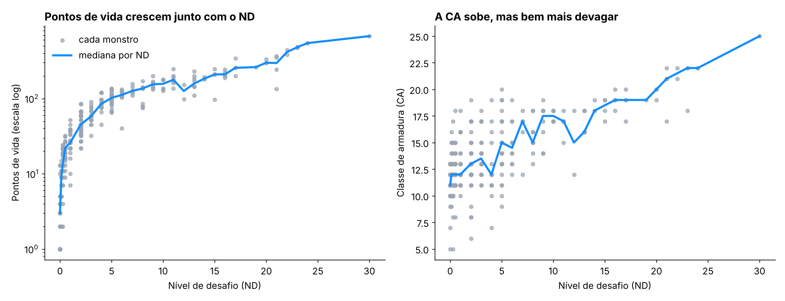

# D&D 5e: o nível de desafio dos monstros bate com os números?

Análise exploratória dos 334 monstros do SRD de D&D 5e para checar se o **nível de desafio (ND)** acompanha pontos de vida, classe de armadura e XP, e quais monstros fogem do padrão. Feito com Python (pandas, matplotlib).

## Principais resultados
- **PV acompanha o ND quase perfeitamente** (correlação de Spearman 0,97). **CA acompanha menos** (0,68).
- **Dragões** (ND mediano 10) e **demônios** (8) são os tipos mais perigosos; **feras** (0,25) os menos.
- **Fora do padrão em PV:** Quasit, Mage e Imp têm bem menos PV que o típico do ND; Giant Octopus, Ogre Zombie e Gelatinous Cube, bem mais.
- **O XP segue o ND em 328 de 334 monstros.** Seis têm XP menor que o usual do seu ND (ex.: Dretch, Frog).



## Fonte dos dados
Lista de monstros do SRD 5e (edição 2014) do repositório [5e-bits/5e-database](https://github.com/5e-bits/5e-database) (MIT), o mesmo conteúdo da API dnd5eapi.co. Os dados não ficam neste repositório; o script baixa.

## Passo a passo
- [x] [01 · Pergunta e objetivo](docs/01-pergunta.md)
- [x] [02 · Dados](docs/02-dados.md)
- [x] [03 · Limpeza](docs/03-limpeza.md)
- [x] [04 · Análise e resultados](docs/04-analise.md)

## Como reproduzir
```
pip install pandas matplotlib scipy
python scripts/coleta.py
python scripts/limpeza.py
python scripts/analise.py
```
(Rodar a partir da pasta do projeto.)

## Por que este tema
Jogo RPG de mesa e queria praticar análise com dados que eu conheço bem.
