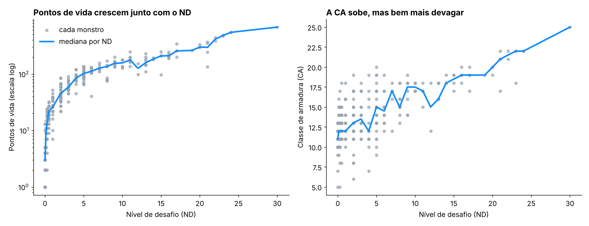
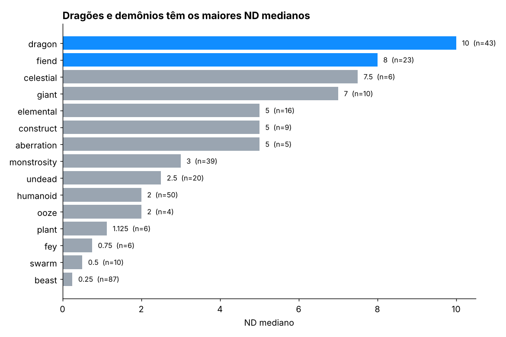

# 04 · Análise e resultados

Script: `scripts/analise.py`. Gráficos em `graficos/`.

## 1. PV e CA acompanham o ND?
Sim, mas em intensidades diferentes. A correlação de Spearman com o ND é **0,97 para PV** e **0,68 para CA**. Os PV sobem de uma mediana de 3 (ND 0) para 676 (ND 30). A CA só vai de cerca de 11 para 25 e varia mais entre monstros do mesmo ND.

## 2. Quem foge do PV típico do ND?
Comparei cada monstro com a mediana de PV do seu ND (só NDs com 5 monstros ou mais, e ND a partir de 1).
- **Bem abaixo:** Quasit (7 PV, ND 1, típico 26), Mage (40 PV, ND 6, típico 112), Imp (10 PV, ND 1).
- **Bem acima:** Giant Octopus (52 PV, ND 1, típico 26), Ogre Zombie (85 PV, ND 2, típico 45), Gelatinous Cube (84 PV, ND 2).

Leitura: os "abaixo" são conjuradores ou criaturas que valem pelas habilidades; os "acima" são bichos resistentes e pouco ofensivos. Isso é uma hipótese minha a partir dos nomes, não foi testada nos dados.

## 3. ND por tipo de criatura
Dragões (mediana 10) e demônios (8) lideram. Feras (0,25) e enxames (0,5) ficam embaixo. Tipos com poucos monstros (celestial, aberration, ooze) têm mediana pouco confiável: veja o `n` no gráfico.

## 4. Lendários
Os 32 monstros lendários têm ND de 5 a 30, mediana 17. Os 302 não lendários vão de 0 a 20, mediana 2. A diferença é grande, mas é em parte esperada: o monstro lendário é feito para ser chefe.

## 5. XP é função do ND?
Quase. Dos 334 monstros, 328 seguem o XP mais comum do seu ND. Seis fogem: Brass Dragon Wyrmling, Deep Gnome, Dretch, Frog, Riding Horse e Sea Horse (têm XP menor que o usual do ND, em geral a metade). Não sei se é intencional no livro ou erro nos dados; fica como ponto a conferir na fonte.

## Limitações
- Só monstros do SRD (334), não do livro completo.
- Correlação não é causa: o ND é definido por quem escreveu o livro, não medido em partidas.
- Não considerei dano causado, que é metade do que o ND mede.
